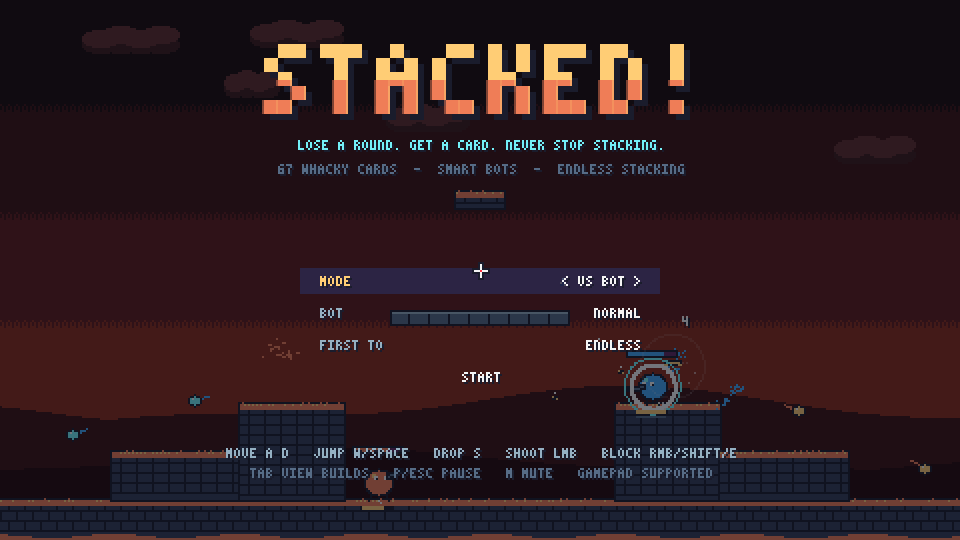
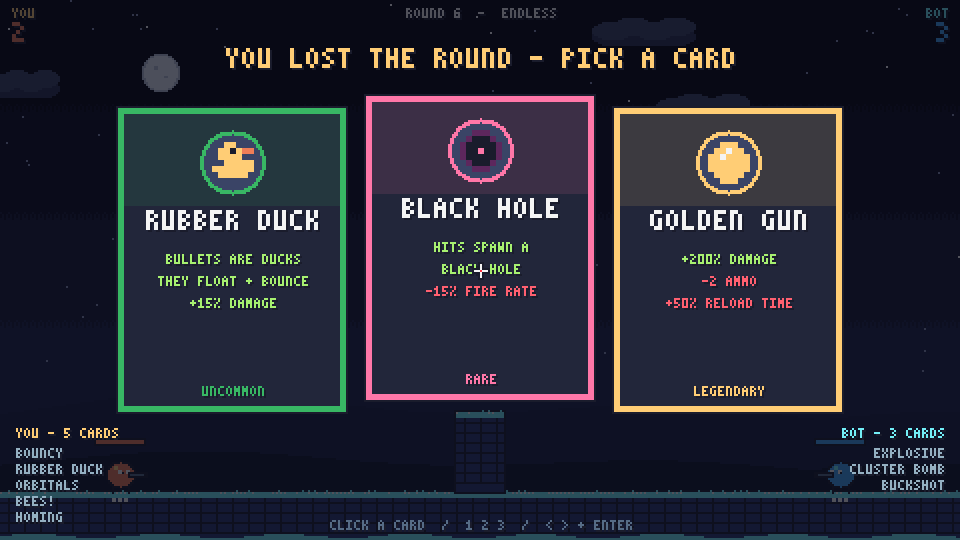
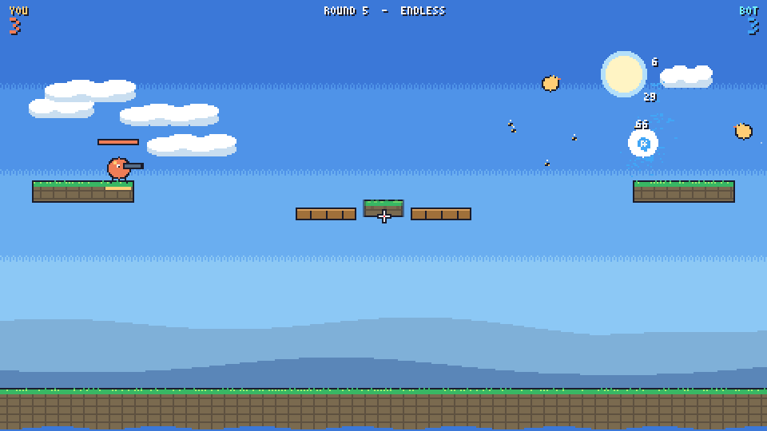
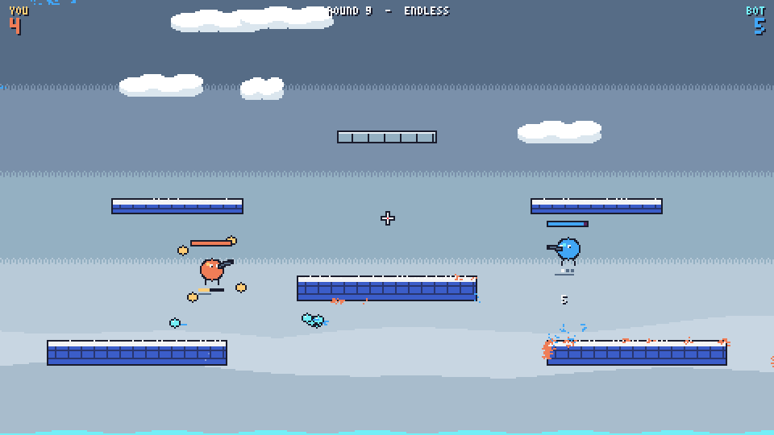
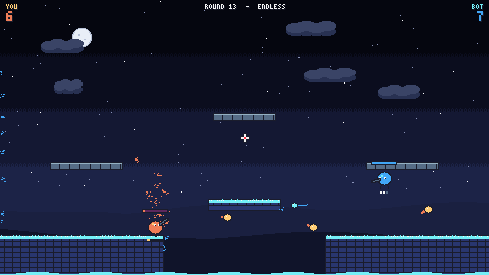

# STACKED!

**Lose a round. Get a card. Never stop stacking.**

A whacky pixel-art 1v1 duel in the spirit of *ROUNDS* and *Stick Fight*. Every time you lose a round you pick one of three cards: power-ups that change your gun, your body or your block. Cards stack forever with no cap, so a match keeps getting stranger the longer it goes. You play against a bot, against a friend on the same computer, or you can sit back and watch two bots fight.

It is one HTML file with no dependencies or asset files. All the art is pixel art drawn in code, and all the sound and music is synthesised live with the Web Audio API.



## Play

```sh
git clone https://github.com/des1-gner/stacked.git
cd stacked
open index.html        # macOS. On Linux use xdg-open, on Windows use start
```

No build step and no server needed. Audio starts after your first click or key press, because browsers block autoplay.

## Controls

| Action | Keyboard + mouse | Gamepad |
|---|---|---|
| Move | `A` / `D` | Left stick / d-pad |
| Jump (wall jump against walls) | `W` / `Space` | A |
| Drop through thin platforms | `S` | Stick down |
| Aim | Mouse | Right stick |
| Shoot | Left click | RT / RB |
| Block | Right click / `Shift` / `E` | LT / LB / B |
| Show both players' cards | Hold `Tab` | |
| Pause / mute | `P` or `Esc` / `M` | Start |

**2 Players:** P1 uses WASD and the mouse. P2 uses the arrow keys, `/` to shoot and `.` to block, with automatic aim. P2 can use a gamepad instead.

Picking a card: click it, press `1` `2` `3`, or use the arrow keys and `Enter`.



## How it works

- **Rounds:** first to 5, 10 or 20 wins, or **endless**. Each round is on a random arena: 7 fixed layouts plus a randomly generated one, each with one of 6 colour themes.
- **Losing gives you a card.** Pick 1 of 3, dealt by rarity: Common, Uncommon, Rare or Legendary. Cards stack with copies of themselves.
- **Comeback bonus:** lose 3 rounds in a row and you pick 2 cards.
- **? crates** drop during each round. Grab one for a random card that lasts until the round ends.
- **Blocking** stops bullets that hit you, then goes on cooldown. Many cards add effects when you block.
- **Bouncing your own bullets off walls is dangerous:** once a bullet has bounced, it can hit you too (for half damage).
- Falling off the bottom of the arena costs 25 HP and launches you back up.



## 67 cards

**Inspired by ROUNDS:** Big Bullets, Bouncy, Buckshot, Quick Reload, Spray, Huge, Glass Cannon, Homing, Explosive, Poison, Leech, Teleport, Shockwave, Defender, Empower, Phoenix, Taste of Blood, Splitter, Trickster, Frost, Thorns, Regeneration, Tiny.

**New twists:**

| Card | What it does |
|---|---|
| Rubber Duck | Your bullets are ducks. They float, bounce and quack |
| Black Hole | Hits leave a black hole that pulls in your opponent and their bullets |
| Bees! | Every shot also releases homing bees |
| Banana Peel | Blocking drops a peel. Your opponent slips and spins |
| Sawblades | Bullets stick in walls as spinning saws |
| Thunderstruck | Every 5th shot calls down lightning where you aim |
| Orbitals | Orbs circle you, hitting your opponent and stopping their bullets |
| Echo | Every shot fires again a moment later |
| Boomerang | Bullets turn around and come back |
| Anti-Gravity | Bullets fall up, and hits make your opponent floaty |
| Time Warp | Blocking slows your opponent and their bullets |
| Shrink Ray / Growth Spurt | Hits shrink your opponent, or make you bigger and stronger, for the rest of the round |
| Ghost | You turn invisible while you're not shooting |
| Landmines, Turret, Dash | Reloading drops a mine, and blocking deploys a turret or dashes you |
| Jetpack, Bounce House, Moon Boots | Hold jump to fly, bounce off the floor, or get an extra jump |
| Cluster Bomb, Grenade Launcher, Fireworks | Bomblets, heavy arcing shells, bullets that burst into sparks |
| Static, Pinball, Phase Rounds | Bullets zap your opponent as they pass by, speed up on every bounce, or pass through walls |
| Sniper, Minigun, Cowboy, Rocket Jump, Heavy Metal | Gun styles that change how you play |
| Spiky, Bubble Shield, Second Wind | Contact damage, a shield at the start of each round, an emergency heal |
| Party Hat | +5% to everything, and confetti |

**Legendary:** Golden Gun (triple damage, less ammo), Overclock (double fire rate, half reload time), Vampire (big lifesteal plus regeneration) and Deja Vu (copies your last 2 cards). **Chaos** is a rare card that gives you 2 random cards.



## The bot

There are four difficulty levels: Easy, Normal, Hard and Insane. The bot:

- **Moves around the arena:** keeps a distance that suits its gun, strafes, jumps gaps and walls, drops through thin platforms, and recovers when it falls off.
- **Aims:** works out a firing angle for its current bullets, leading moving targets and arcing heavy shots like grenades.
- **Defends:** spots bullets heading for it, then blocks or jumps. How fast it reacts depends on difficulty.
- **Plays its cards:** uses its blocking cards on purpose, goes for crates, and loses track of you while you're invisible.

**Bot vs Bot** mode lets you watch two bots stack builds without end. A bot match also plays behind the title screen.



## Tech

- Plain JavaScript and an HTML5 canvas.
- The game draws at 480×270, scales up in whole steps to keep the pixels sharp, and runs its game logic at a fixed 60 updates per second.
- Stats are rebuilt from your card list each round, so stacking any number of cards stays consistent.
- Caps on bullets, particles and per-shot counts keep it running smoothly at any build size.

## Credits

Inspired by *ROUNDS* (Landfall) and *Stick Fight: The Game*. This is a fan tribute and is not affiliated with either.
